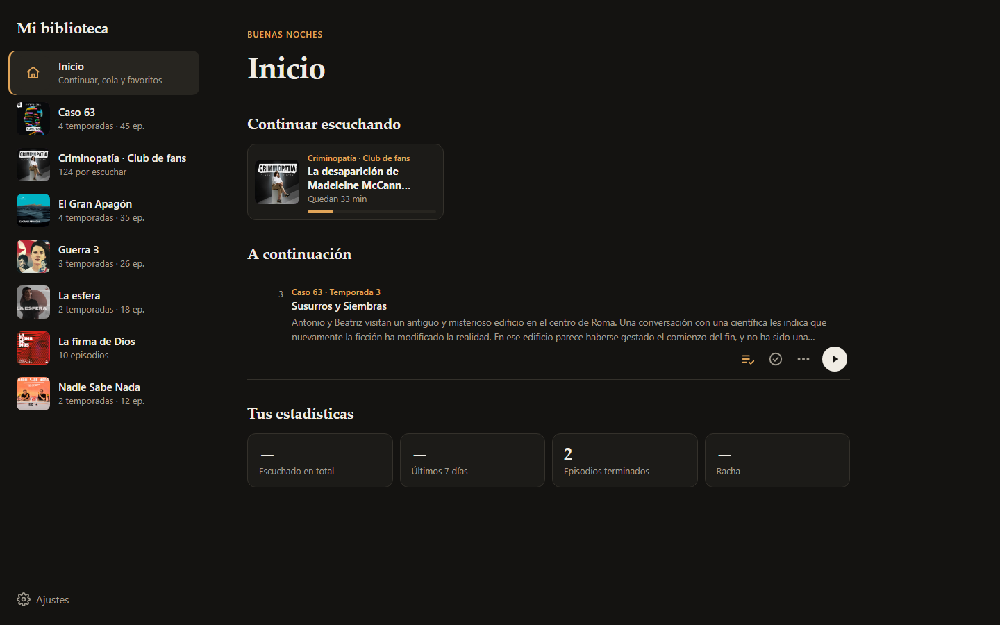
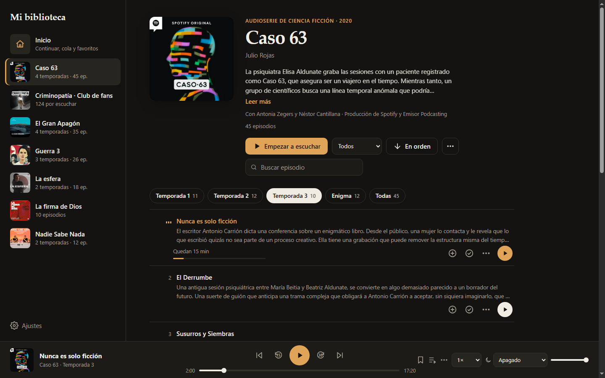
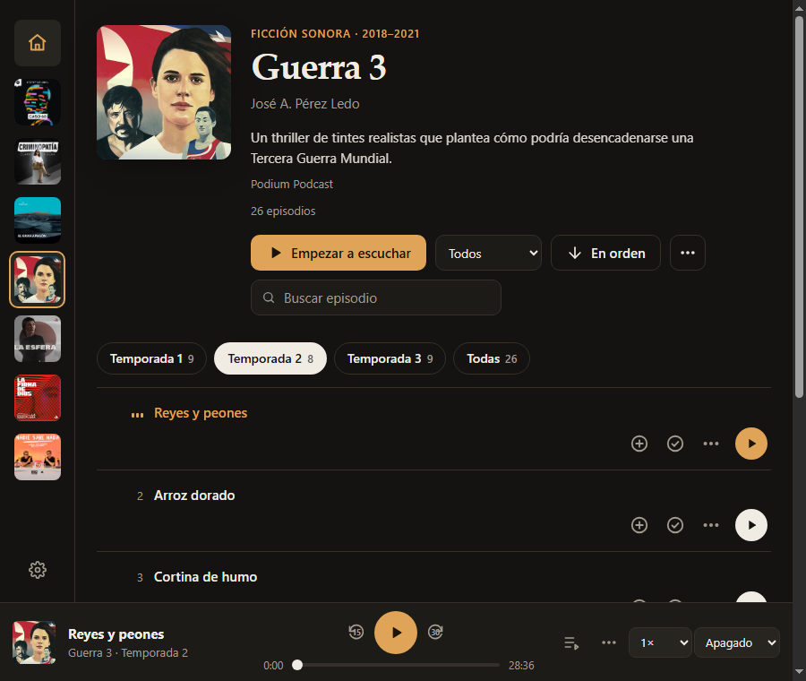
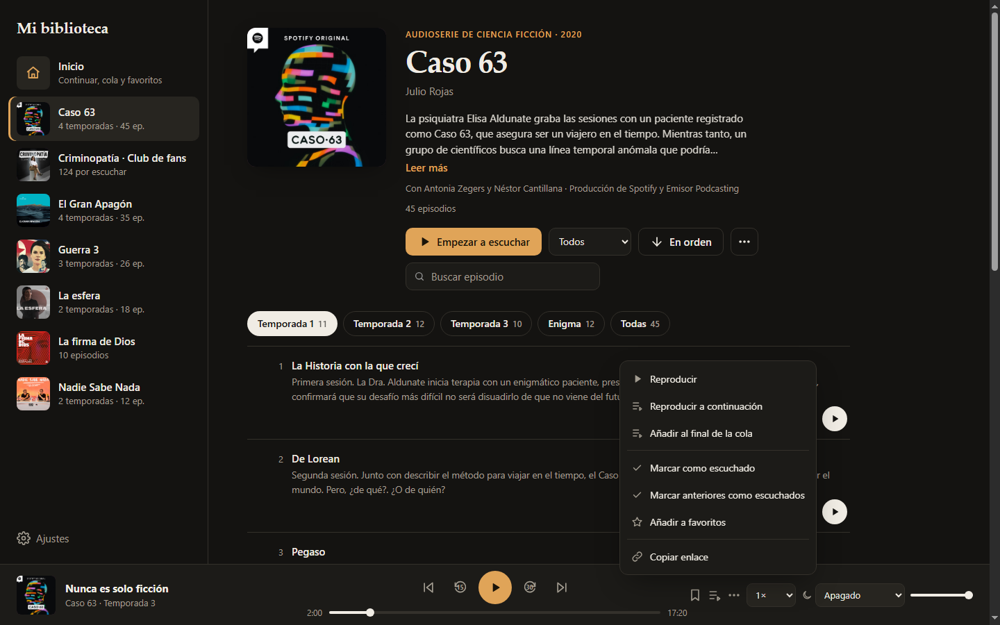
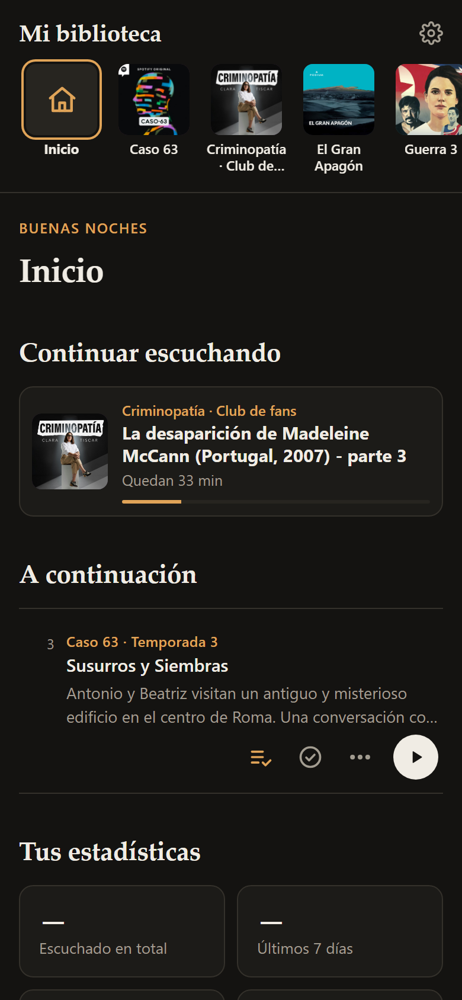
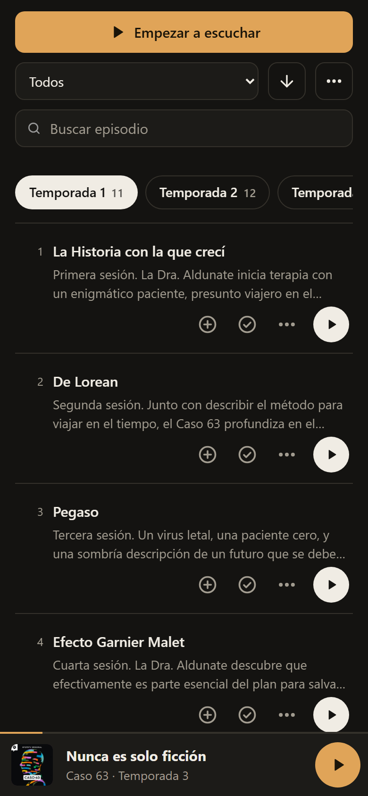
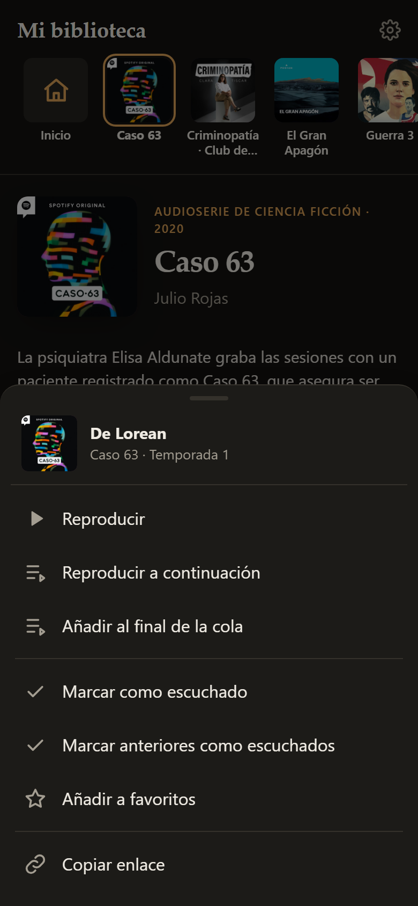
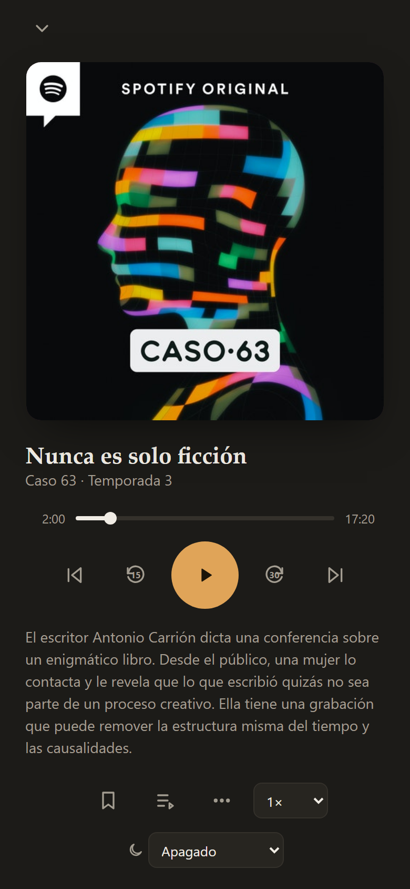

# Mi biblioteca sonora

Un reproductor web sencillo para escuchar **podcasts y audioseries que ya tienes descargados** en una carpeta. Pensado para usarlo en casa, desde el navegador del PC o del móvil, sin cuentas ni servicios externos.

Es un proyecto personal y pequeño:

- **Sin dependencias.** Solo Node.js; nada de `npm install`.
- **Sin login por defecto.** Está pensado para uso local o dentro de una red privada (por ejemplo, Tailscale). Si lo necesitas, hay un inicio de sesión opcional.
- **Sin base de datos.** El progreso se guarda en ficheros JSON en `data/`.



## Capturas

| Escritorio | Ventana mediana |
|---|---|
|  |  |
|  | |

| Móvil: inicio | Móvil: serie | Móvil: menú ⋯ | Móvil: reproductor |
|---|---|---|---|
|  |  |  |  |

## Qué hace

- **Biblioteca a partir de carpetas:** cada subcarpeta es una serie y sus audios son los episodios (`mp3`, `m4a`, `ogg`, `opus`, `wav`, `flac`, `aac`).
- **Datos de los propios archivos:**
  - Lee las etiquetas ID3: título, autor, año, descripción, portada y capítulos.
  - Si no hay portada en las etiquetas, usa un `cover.jpg` de la carpeta.
- **Temporadas automáticas:** se detectan por el nombre del archivo (`T2E3`, `T02E03`, `2x01`…) y se muestran en pestañas.
- **Inicio:**
  - «Continuar escuchando» y el siguiente episodio de cada serie empezada.
  - La cola, favoritos y marcadores.
  - Estadísticas de escucha.
- **Por episodio:** botones para añadir a la cola, marcar como escuchado o no, favoritos y copiar un enlace a un minuto concreto.
- **Reproductor:**
  - Velocidad variable (también por serie), y saltar la intro o el final de cada serie.
  - Temporizador de apagado con fundido al final.
  - Marcadores con nota y atajos de teclado.
  - Controles en la pantalla de bloqueo (Media Session).
- **Adaptable:** escritorio, ventanas pequeñas (la barra lateral se pliega) y móvil (reproductor a pantalla completa y menús en hoja inferior).
- **Progreso guardado en el servidor:** se sincroniza entre dispositivos.

## Uso rápido

### Con Node.js (18 o superior)

```sh
PODCAST_DIR=/ruta/a/tus/podcasts node server.js
# abre http://127.0.0.1:48213
```

Variables útiles:

| Variable | Por defecto | Para qué |
|---|---|---|
| `PODCAST_DIR` | `./podcasts` | Carpeta con tus series |
| `HOST` | `127.0.0.1` | Interfaz donde escucha (`0.0.0.0` para tu red) |
| `PORT` | `48213` | Puerto |
| `ALLOWED_HOSTS` | *(vacío)* | Lista de `host:puerto` aceptados (protege de DNS rebinding) |
| `AUTH` | `off` | `on` pide usuario y contraseña (`node manage-users.js add <usuario>`) |

### Con Docker

```sh
cp .env.example .env   # ajusta BIND_IP, PODCAST_DIR y ALLOWED_HOSTS
docker compose up -d --build
```

El contenedor arranca solo con el equipo y viene endurecido:
- Corre con un usuario sin privilegios, con el sistema de ficheros de solo lectura y sin capacidades de Linux.
- La carpeta de podcasts se monta en solo lectura.
- Solo puede escribir en `data/`.

## Organizar la biblioteca

```
podcasts/
├── Mi audioserie/
│   ├── cover.jpg            (opcional)
│   ├── 01 - T1E1 - Piloto.mp3
│   └── 02 - T1E2 - Segundo.mp3
└── Otro podcast/
    └── ...
```

Para corregir títulos, añadir sinopsis o definir temporadas especiales, crea `data/library.json` (mira `data/library.example.json`). Las portadas propias pueden ir en `data/covers/<nombre de la carpeta>.jpg`.

## App para Android

En `android/` hay una app mínima que abre la web a pantalla completa. Para compilarla necesitas el SDK de Android (build-tools 34) y un JDK; no hace falta Gradle:

```sh
APP_URL=http://TU-IP:48213/ sh android/build.sh
# -> android/build/MiBiblioteca.apk
```

## Futuro

La idea es mantenerlo simple. Más adelante me gustaría integrarlo en algo más completo, como **Jellyfin** (o Audiobookshelf), y aprovechar su gestión de usuarios y bibliotecas.

---

Las portadas y los podcasts de las capturas pertenecen a sus autores; aparecen solo para mostrar cómo se ve la aplicación.
